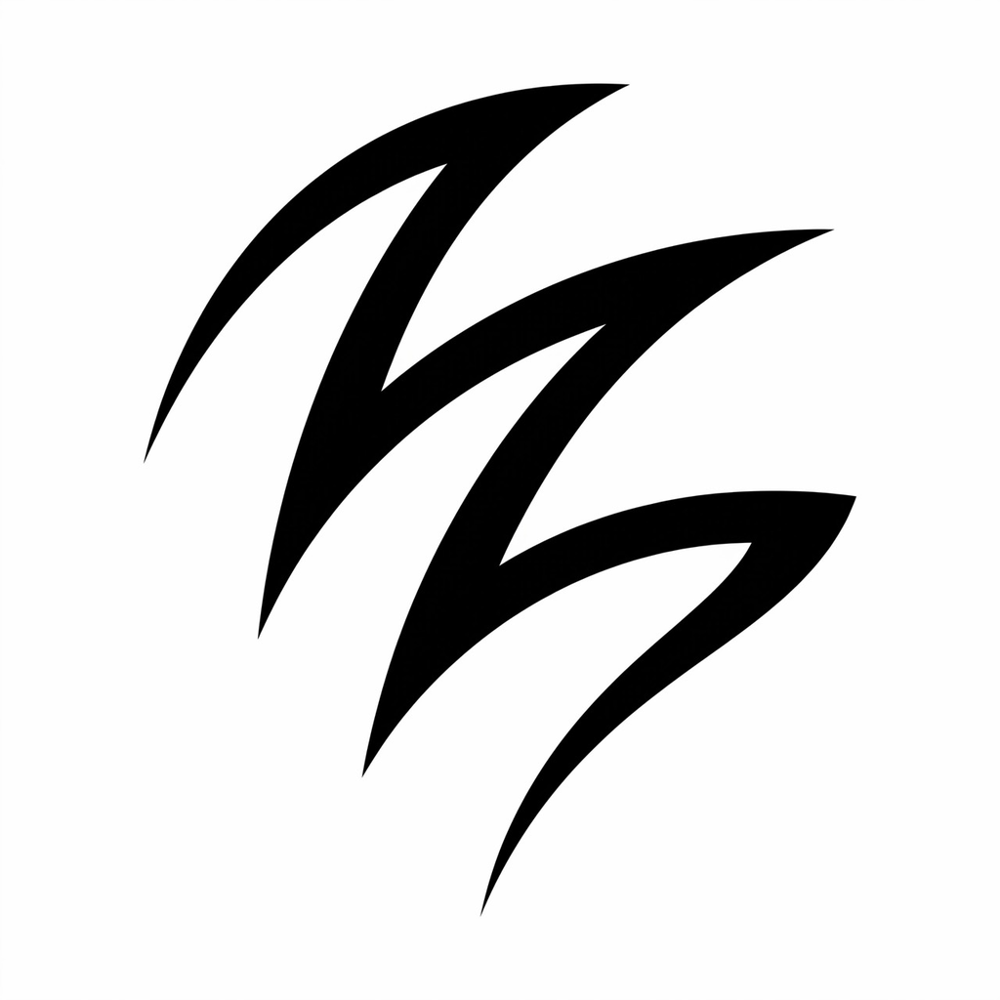

  

<h1 align="center">Claw</h1>

<strong>Performance-focused emulation for iPhone.</strong>

Claw brings 3DS, DS, Game Boy Advance, Game Boy Color, Game Boy, and NES games into one native iPhone app. It pairs Metal-backed rendering and device-aware graphics settings with a focused game library, responsive controls, and local save states.

## Features

- **Performance first.** A native emulation frontend with Metal-backed rendering, device-aware defaults, and optional MetalFX upscaling for 3DS on supported hardware.
- **Six systems, one library.** Import compatible game files from Files, organize your collection, and return to recently played games.
- **Play at your pace.** Normal, 2×, and 4× speed controls, with optional on-screen performance information.
- **Your controls.** Built-in Obsidian layouts, imported skins, portrait and landscape play, and compatible game-controller support.
- **Keep your progress.** Local automatic snapshots, manual save slots, and save export through the iOS share sheet.
- **A native iPhone experience.** SwiftUI and UIKit, light and dark appearance, and support for iOS 17 and later.

Compatibility, rendering options, and achievable speed depend on the game and device. Claw does not require JIT.

## Supported systems

| System | Supported files |
| --- | --- |
| Nintendo 3DS | `.3ds`, `.cci`, `.cxi`, `.app`, supported decrypted base-game `.cia` |
| Nintendo DS | `.nds` |
| Game Boy Advance | `.gba` |
| Game Boy Color | `.gbc` |
| Game Boy | `.gb` |
| Nintendo Entertainment System | `.nes` |

Single-game ZIP and 7z archives can be imported directly. No games, console keys, BIOS, or firmware are included. Supply only files you have the right to use.

## Build

Claw is built with Xcode on macOS. See the build guide for the project, scheme, dependency preparation, and signing configuration used by this source snapshot.

See [Building Claw](Docs/Building.md) for setup and signing, [supported systems](Docs/SupportedSystems.md) for system-specific details, and [runtime architecture](Docs/RuntimeArchitecture.md) for the native integration.

## Support

For help and source-access questions, contact [feedback@salamlabs.io](mailto:feedback@salamlabs.io).

## Open source and acknowledgements

Claw is open source under the [GNU General Public License v3](LICENSE). Its emulation cores and dependencies retain their own licenses and attribution, including Cytrus/Azahar/Citra, the bundled libretro cores, MoltenVK, FFmpeg, and Boost.

Dependency sources, revisions, build recipes, and notices are retained in [ThirdParty](ThirdParty/), [Distribution](Distribution/), and [App/Legal](App/Legal/).

Claw is an independent project and is not affiliated with, sponsored by, or endorsed by Nintendo or any other console manufacturer. Console names and trademarks belong to their respective owners and identify platform compatibility.

## Source snapshots

[SOURCE_SNAPSHOT.json](SOURCE_SNAPSHOT.json) records the development revision and exported file hashes. Tagged releases identify earlier snapshots; the current branch also includes documentation cleanup.
